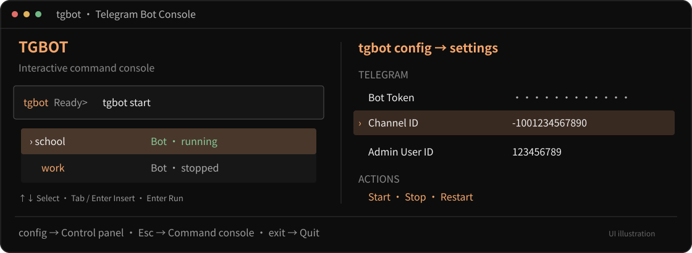

<div align="center">

# Telegram Bot Console

**一個指令管理多台 Telegram 匿名投稿機器人。**

指令即時提示 · 多位管理員 · 多群組同步投稿 · 每台資料獨立

[](https://github.com/zephyr-154/telegram-bot-console/actions/workflows/ci.yml)
[](https://www.python.org/)
[](LICENSE)
[](#常用指令)

[快速安裝](#快速安裝) · [第一次啟動](#第一次啟動) · [常用指令](#常用指令) · [VPS 部署](docs/VPS.md) · [完整操作手冊](docs/MULTI_BOT_CLI.md)

</div>



在同一台電腦或 VPS 部署多個機器人：執行 `tgbot` 開啟有輸入框的指令介面，輸入 `tgbot start` 並加空格，就會即時列出機器人名稱。輸入 `tgbot config` 才開啟控制面板，再選擇機器人編輯設定。投稿者私訊文字、確認發布後，機器人會產生繁中字卡，匿名發到指定群組、超級群組或頻道。

> **匿名範圍：** 貼文不顯示投稿者身分；系統仍保存 Telegram User ID，供原作者刪文、限流與管理員處理。請閱讀[資料與隱私](#資料與隱私)。上圖為操作示意，狀態與數字為範例。

## 有哪些功能

- **互動指令介面：** `tgbot` 開啟輸入框，指令與名稱即時提示；↑↓ 選取、Tab／Enter 帶入，再按 Enter 執行。
- **多機器人控制台：** `tgbot config` 查看狀態、PID、每台記憶體與主機記憶體使用率；支援新增、設定、啟停、重啟及刪除。
- **鍵盤設定：** ↑↓ 選擇、Enter 編輯、Ctrl+S 儲存、Esc 返回；Token 隱藏輸入，各台自動產生獨立秘密金鑰。
- **群組／頻道偵測：** 先填 Token 開始偵測，再邀請 Bot 加入；清單自動顯示名稱與 ID，支援方向鍵選取、名稱搜尋或手動輸入 ID。
- **多人與多目標：** 邀請人可列為管理員候選，也能拉取所選群組的管理員名單；Space 勾選多位管理員與多個投稿目標，每篇投稿同步發布到所有已選目標。
- **匿名投稿：** 純文字最多 4000 字，發布前二次確認；長文自動排版為最多 10 張 1080 × 1350 字卡。
- **投稿管理：** 本人投稿分頁、刪文確認、檢舉、管理員封鎖、暫停投稿及待處理事項核對。
- **資料保護：** 每台獨立設定、SQLite 資料庫、備份與輪替日誌；避免重複部署同一 Token，停止程序會核對身分。
- **穩定發送：** 發文排隊、背景製圖、限流與 Telegram 重試處理；送出結果不明時保留紀錄供核對。

## 快速安裝

安裝後會建立獨立 Python 環境，並提供全域 `tgbot` 指令。**不需要先安裝 Python 或 Git，也不需要到 PyPI 找套件**；uv 會取得 Python 3.12，並直接安裝這個 GitHub 專案。

### Windows · CMD / PowerShell

先安裝 [uv](https://docs.astral.sh/uv/getting-started/installation/)，CMD 與 PowerShell 都可以執行：

```powershell
powershell -ExecutionPolicy ByPass -c "irm https://astral.sh/uv/install.ps1 | iex"
```

**完全關閉 Windows Terminal／CMD／PowerShell，再重新開啟**，接著執行：

```powershell
uv tool install --python 3.12 "https://github.com/zephyr-154/telegram-bot-console/archive/refs/heads/main.zip"
uv tool update-shell
tgbot
```

如果安裝後仍顯示「`tgbot` 不是內部或外部命令」，再完全關閉終端並重開。預設安裝位置也可以立即加入目前視窗的 PATH：

<details>
<summary>立即刷新目前終端的 PATH</summary>

CMD：

```cmd
set "PATH=%USERPROFILE%\.local\bin;%PATH%"
tgbot
```

PowerShell：

```powershell
$env:Path = "$env:USERPROFILE\.local\bin;$env:Path"
tgbot
```

若自行調整過 uv 的工具目錄，請以 `uv tool dir --bin` 顯示的位置為準。

</details>

Windows 會自動尋找微軟正黑體。沒有此字型時，可從 [Noto 官方字型專案](https://github.com/notofonts/noto-cjk/tree/main/Sans/OTF/TraditionalChinese)取得 Regular、Bold 字型，再於設定面板指定實際檔案路徑。

### Linux · Ubuntu / Debian

先安裝繁中字型與下載工具：

```bash
sudo apt update
sudo apt install -y curl ca-certificates fonts-noto-cjk
curl -LsSf https://astral.sh/uv/install.sh | sh
. "$HOME/.local/bin/env"
uv tool install --python 3.12 "https://github.com/zephyr-154/telegram-bot-console/archive/refs/heads/main.zip"
uv tool update-shell
tgbot
```

適合一般使用者安裝。其他 Linux 發行版也可使用 uv，需另外安裝繁中字型，並在設定面板指定路徑。需要 VPS 重開機後自動啟動，請接著閱讀 [systemd 部署步驟](docs/VPS.md)。

### macOS · Terminal

已安裝 [Homebrew](https://brew.sh/) 時：

```bash
brew install uv
brew install --cask font-noto-sans-cjk-tc
uv tool install --python 3.12 "https://github.com/zephyr-154/telegram-bot-console/archive/refs/heads/main.zip"
uv tool update-shell
tgbot
```

程式會尋找 `~/Library/Fonts` 與 `/Library/Fonts` 中的 `NotoSansCJKtc-Regular.otf`、`NotoSansCJKtc-Bold.otf`。[Homebrew 字型套件](https://formulae.brew.sh/cask/font-noto-sans-cjk-tc)會安裝對應字型；使用自訂字型目錄時，請於面板調整路徑。

<details>
<summary>沒有 Homebrew：使用 uv 官方安裝程式</summary>

```bash
curl -LsSf https://astral.sh/uv/install.sh | sh
. "$HOME/.local/bin/env"
uv tool install --python 3.12 "https://github.com/zephyr-154/telegram-bot-console/archive/refs/heads/main.zip"
uv tool update-shell
```

另外下載並安裝 [Noto 繁中字型](https://github.com/notofonts/noto-cjk/tree/main/Sans/OTF/TraditionalChinese)，或在機器人設定中指定已安裝字型的檔案路徑，再執行 `tgbot`。

</details>

> 安裝網址跟隨 `main` 分支。這是 GitHub 原始碼安裝，Python 套件名稱是 `telegram-anonymous-board`，終端指令是 `tgbot`。目前沒有宣稱已發布至 PyPI。

## 第一次啟動

1. 在 Telegram 的 [@BotFather](https://t.me/BotFather) 建立 Bot，取得 **Bot Token**。
2. 執行 `tgbot`，在輸入框輸入 `tgbot config`，選擇「新增機器人」並輸入名稱，例如 `school`。
3. 在 **Bot Token** 按 Enter 輸入 Token，再按 Enter 套用；移到下一列 **偵測群組／頻道** 按 Enter。這一步不必先填其他欄位或 Ctrl+S 儲存。
4. 畫面顯示「等待邀請」後，到 Telegram 邀請 Bot 加入群組或頻道。回到 **目標群組／頻道 ID** 按 Enter，以 ↓ 選名稱與 ID；Enter 可單選，Space 可勾選多個，再按 Enter 套用。也能搜尋名稱或手動輸入逗號分隔的 ID。
5. 選擇 **拉取群組管理員**，再到 **管理員 User ID** 選擇邀請人或已取得的管理員；Space 可勾選多位，Enter 套用。每位管理員先私訊自己的 Bot 按 `/start`，才能接收通知。確認各目標的圖片、發文與刪文權限及字型路徑，按 **Ctrl+S 儲存**。
6. 在面板選擇「背景啟動」，或執行以下指令：

```bash
tgbot check school
tgbot start school
tgbot status
```

目標 ID 必須是負整數，超級群組與頻道通常為 `-100…`；管理員 User ID 是正整數。`check` 只驗證本機設定，`start` 才會連線檢查 Token 與目標權限。顯示「執行中」後，投稿者即可私訊 Bot。

同一台機器人的所有指定管理員具有相同管理權限，共同管理所有已選目標。候選名單不會自動授權，選取並儲存後才生效。舊版的單一 ID 設定可直接沿用；多個 ID 使用逗號分隔：

```dotenv
CHANNEL_ID=-1001234567890,-1009876543210
ADMIN_USER_ID=123456789,987654321
```

每篇稿件只製圖一次，依序送到所有目標並遵守原有節流。投稿確認畫面顯示目標數量；目標設定改變後，舊確認會要求重新投稿。刪文會處理原本記錄的所有副本，移除設定中的群組不會漏刪舊副本。部分發送失敗時會嘗試撤回；結果不明或撤回不完整時保留紀錄供管理員核對，不會直接重送。

已加入的舊群組未出現時，在開始偵測後傳送 `/start@你的機器人帳號`；頻道則發一則新貼文。正式背景程序也會持續登記群組，不必一直開著面板。Telegram 不提供全部既有群組名單；偵測只包含收到通知或曾記錄的群組。更多操作與限制見[即時群組／頻道偵測](docs/MULTI_BOT_CLI.md#即時群組頻道偵測)。

再新增另一台，只要使用不同名稱與 Token：

```bash
tgbot add work
tgbot start
```

名稱可使用 1～40 個中英文字、數字、底線、連字號；不可重複。設定變更後，需重啟該台才會生效。關閉面板會保留背景程序；主機關機後則需重新啟動或設定開機服務。

## 常用指令

`tgbot` 開啟互動指令介面。可在輸入框輸入完整的 `tgbot start school`，也可簡寫成 `start school` 或 `/start school`。輸入 `help` 查看說明，`exit`、Ctrl+C 或 Ctrl+D 離開；背景機器人繼續執行。

在互動輸入框中，輸入 `tgbot start` 後按空格，就會看到名稱與狀態，例如：

```text
tgbot Ready> tgbot start
  school       機器人 · 已停止
  work         機器人 · 執行中
```

輸入部分名稱可即時篩選；↑↓ 選取，Tab 或第一次 Enter 帶入，再按 Enter 執行。這些即時提示會顯示在 `tgbot` 互動介面內。外層 CMD、PowerShell 或 SSH 終端仍可直接執行下列單次指令。

以下 `#` 後方是說明；CMD 使用者請只執行 `#` 前方的指令。

### 控制面板與設定

```bash
tgbot                       # 打開互動指令介面
tgbot config                # 開啟多機器人控制面板
tgbot add school            # 新增並開啟設定
tgbot config school         # 修改指定機器人
tgbot status                # 查看所有機器人狀態
tgbot names                 # 只列出機器人名稱
tgbot check                 # 檢查所有機器人的本機設定
tgbot logs school           # 查看最近 40 行日誌
```

### 背景執行

```bash
tgbot start                 # 啟動全部
tgbot start school          # 啟動指定機器人
tgbot start --select        # 顯示名稱選單再啟動
tgbot stop                  # 停止全部
tgbot stop school           # 停止指定機器人
tgbot restart               # 重啟全部機器人
tgbot restart school        # 重啟指定機器人
```

`tgbot config sch` 可篩選名稱。設定面板按 Esc 返回上一層，離開控制面板後回到指令輸入框。沒有互動式終端時會使用文字輸入與編號選單。完整快捷鍵與程序行為請見[操作手冊](docs/MULTI_BOT_CLI.md)。

### 備份與還原

```bash
tgbot backup school
tgbot stop school
tgbot restore school "/完整路徑/備份.sqlite3"
tgbot start school
```

備份使用 SQLite Online Backup API，包含 WAL 已提交資料，保留最近 **7 份**。`backup` 結束會顯示備份路徑；Windows 請使用實際的磁碟路徑。還原前必須停止該台，程式會先建立現況安全備份，還原後暫停投稿並清空舊待確認稿件，管理員核對 Telegram 貼文後再恢復投稿。

資料庫備份沒有包含 Bot Token、字型及 `CONTENT_HASH_SECRET`，請另外安全保存設定。多機器人模式目前提供手動備份；需要排程時可安排各台的 `backup` 指令。

### 刪除與解除安裝

```bash
tgbot delete school         # 停止並刪除這一台的設定及資料
tgbot app delete            # 停止全部，完整解除安裝及刪除管理目錄
```

刪除單台需輸入名稱確認，完整移除需輸入 `DELETE ALL`。兩者都會刪除相應本機資料庫、設定、備份與日誌；群組歷史貼文及 BotFather 中的 Bot 仍會保留。完整自動解除安裝適用本文件的 **uv 工具安裝版**，會在 CLI 結束後執行，並顯示結果日誌位置。

只移除程式、保留機器人資料：

```bash
tgbot stop
uv tool uninstall telegram-anonymous-board
```

## 更新版本

先停止並備份每台機器人，再重新安裝：

```bash
tgbot stop
tgbot backup school
tgbot backup work
uv tool install --reinstall --refresh --python 3.12 "https://github.com/zephyr-154/telegram-bot-console/archive/refs/heads/main.zip"
tgbot --version
tgbot check
tgbot start
```

將 `school`、`work` 改成你的名稱，沒有的機器人不用備份。更新程式會保留管理目錄；不要重設既有 `CONTENT_HASH_SECRET`，才能繼續比對舊投稿的內容 HMAC。舊版單機器人 `.env` 不會自動搬移，可先使用 `tgbot run --config "舊設定檔路徑"`，詳見[舊版部署說明](docs/LEGACY_DEPLOYMENT.md)。

## 資料與隱私

管理目錄預設位置：

- **Windows：** `%LOCALAPPDATA%\TelegramAnonymousBoard`
- **Linux / macOS：** `$XDG_CONFIG_HOME/tgbot`；未設定時為 `~/.config/tgbot`
- **自訂位置：** 啟動前設定 `TGBOT_HOME`，並讓面板、啟停指令與開機服務使用同一個目錄。

每台資料存放於 `bots/名稱/`，包含 `.env`、`data/bot.sqlite3`、`data/backups/` 及 `bot.log`。`.env.bak` 是上一次設定，也含秘密資料。請用相同作業系統帳號操作；不要把資料夾放進公開儲存庫。

群組清單 `chats-機器人數字ID.json` 記錄群組／頻道資料、加入狀態，以及取得的邀請人與群組管理員姓名、帳號和 User ID。不保存一般群組訊息內容、一般發言者或 Token。此清單同樣屬於私人資料，已加入忽略規則。

舊版資料庫會先自動備份再加入目標快照欄位，保留文章、訊息 ID 與待確認原文。從單群組舊版升級後，尚未確認多群組發布的舊稿需要重新投稿確認。

成功發布後不另外保存投稿全文，會保存作者 User ID、文章與 Telegram 訊息 ID、時間、狀態及內容 HMAC。待確認原文 24 小時後到期；備份可能保留備份當時的原文及檢舉資料。Telegram 私訊與群組副本仍受 Telegram 本身的資料保存方式影響，`/privacy` 有完整說明。

同一作者同內容 24 小時內不可重複發布，另有 10 分鐘 3 篇、台灣日曆日 20 篇的投稿限制。自動刪文一般限發布後 48 小時內；超時或缺少權限時需要管理員處理。送出結果不明的文章會保留供人工核對，不會直接盲目重送。

## Telegram 內的操作

- `/start`、`/help`：開始使用與操作說明。
- `/myposts`：自己的投稿、連結與可刪除狀態。
- `delete`：經二次確認刪除自己的文章。
- `/report 文章ID 原因`：檢舉文章，每人 10 分鐘最多 3 件，同篇限一件。
- `/cancel`：取消未完成操作。
- `/privacy`：匿名與資料保存說明。
- `/admin`：指定管理員的管理面板；其他帳號不會收到管理資訊。

### 管理員直接發話與置頂

已設定的管理員在 **Telegram 私訊機器人**輸入 `/admin`，選擇「直接發話／公告」：

1. 選擇一個已設定的群組／頻道，或「全部已設定目標」。選單顯示名稱及 ID；無法讀取名稱時仍可依 ID 選擇。
2. 傳送要發出的純文字，確認面板中的內容與目標。可用「重新輸入內容」修改，或 `/cancel` 取消。
3. 選擇「發送（不置頂）」或「發送並置頂」。內容會直接以機器人名義發布，保留換行，不加管理員署名、不轉成投稿圖片，也不計入投稿數或投稿限額；暫停投稿時仍可發公告。
4. 查看各目標的發送、置頂結果與訊息連結。**已發送但置頂失敗時，不要重新發送原文**；可到 Telegram 手動置頂。網路中斷、程式重啟或結果不明時不會自動重送，請先核對目標。

文字上限為 4096 個 UTF-16 字元，部分表情符號占兩個。置頂採靜音方式，群組需授予機器人「置頂訊息」權限，頻道需授予「編輯訊息」權限；詳見 [Telegram 置頂 API 說明](https://core.telegram.org/bots/api#pinchatmessage)。選擇不置頂時，只會發送新訊息，既有置頂不受影響。

發話草稿在確認前暫存於資料庫，取消、送出後會移除，未完成草稿沿用 24 小時清理；備份及 Telegram 私訊仍可能保留內容。公告不建立匿名投稿文章紀錄，也不適用投稿的 `delete` 流程；需要刪除或取消置頂時，請在 Telegram 管理該則訊息。更新到此版本後，管理員入口改用 `/admin`，執行中的機器人需重啟才會套用。

## 開發與測試

需要 Git 與 uv。以下指令適用 CMD、PowerShell、bash、zsh：

```bash
git clone https://github.com/zephyr-154/telegram-bot-console.git
cd telegram-bot-console
uv venv --python 3.12
uv pip install -e ".[test]"
uv run --no-project python -m app.cli
uv run --no-project python -m pytest -q
uv build
uv run --no-project python tests/package_smoke.py
```

`package_smoke.py` 在隔離環境安裝套件，以本機替代程式測試兩台背景程序、重啟、單台刪除及完整解除安裝，不會連線 Telegram，也不會操作正式管理目錄。GitHub Actions 會在 Windows、Ubuntu、macOS 執行測試與建置；缺少繁中字型的環境會明確跳過製圖測試。

原始碼主要位於 `app/`；`deploy/` 提供 systemd 範例與舊版設定腳本；`tests/` 包含投稿、管理、備份與 CLI 測試。字型未隨程式散布，使用時請遵守各字型授權。

遇到問題可[建立 Issue](https://github.com/zephyr-154/telegram-bot-console/issues)，附上作業系統、`tgbot --version` 與已遮蔽敏感資訊的錯誤內容。請勿貼出 Token、秘密金鑰、資料庫或私人投稿。

## 授權

[MIT License](LICENSE) · Copyright © 2026 zephyr-154
